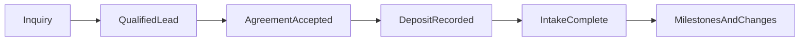

# Product Requirements Document (PRD)

**Product:** Faber Web — developer portfolio, lead generation, and client portal  
**Document version:** 1.1  
**Status:** Living checklist (reflects the codebase)  
**Primary domain:** [faberwebtech.com](https://faberwebtech.com)

This document collates features by version. Checkboxes mark shipped (`[x]`) vs outstanding (`[ ]`). Update statuses as work lands. Schema source of truth remains [`packages/db/src/schema`](packages/db/src/schema) — do not treat illustrative SQL in older drafts as authoritative. Client operations (asset intake, lead qualification, contracts, lightweight project visibility) are specified in [§10](#10-client-operations).

---

## 1. Vision

Establish a high-conversion, edge-native web presence that advertises bespoke technical services and doubles as a proof of modern web engineering. The authenticated portal gives clients transparent project tracking and differentiates the practice from competitors.

**Primary headline (live):** “Your website should be your most relentless employee. Right now, you're doing its job.”

An earlier strapline (“Modern web tech to boost your business.”) is superseded.

---

## 2. Service pillars

| Pillar | Description | Target outcomes |
| --- | --- | --- |
| **Modern Websites** | Lightning-fast, content-driven, SEO-oriented business sites on modern edge/static architecture. | Sub-second loads, 95+ Core Web Vitals, accessible UI, static-edge delivery. |
| **Web Apps** | Interactive full-stack applications and SaaS MVPs. | Type-safe client/server contracts, relational data, secure sessions, edge latency. |
| **AI Automation** | Practical LLM integrations, agent workflows, and backend task automation — reliability over ambition. | Validated workflows first; agents only when the work needs them. |
| **SEO & GEO** | Rank in search and get recommended by AI answer surfaces (ChatGPT, Perplexity, Gemini, AI Overviews). | Discoverability across classic search and generative engines. |

Three-pillar drafts that omit SEO & GEO are superseded.

---

## 3. Technical architecture

| Layer | Choice |
| --- | --- |
| Frontend | Astro (SSG/SSR hybrid, Islands for interactive widgets) |
| Backend | Hono on Cloudflare Workers |
| Typed API | oRPC |
| Database | Cloudflare D1 + Drizzle ORM |
| Auth | Better-Auth (sessions, roles, admin 2FA) |
| Bot verification | Cloudflare Turnstile |
| Email | Cloudflare Email Sending (contact lead notifications) |
| Observability | Evlog (structured events → drain, e.g. Axiom) |
| Infra | Alchemy (`packages/infra`) |

---

## 4. Success metrics (KPIs)

| Metric | Target | Notes |
| --- | --- | --- |
| Speed & performance | Sub-1s perceived load; ≥95 Lighthouse (desktop & mobile) | Stated on the marketing site as a guarantee. |
| Accessibility | WCAG **2.2** AA | Prefer 2.2 over mixed 2.1/2.2 wording in older drafts. |
| Monthly qualified leads | ≥10 / month via contact (+ questionnaire once shipped) | Business target. |
| CTA experiment | Primary: enquiry rate by assigned variant | See [`docs/cta-experiment.md`](docs/cta-experiment.md). Active until a winner is chosen. |
| Questionnaire completion | ≥5% of unique visitors who **start** the questionnaire complete and capture email | Applies after the AI Business Booster ships; does not replace the CTA experiment. |

---

## 5. Personas & journeys (adapted)

### Efficiency-Seeking Eddie (SMB owner/operator)

Pain: admin overhead, curiosity about AI without a clear first step.

1. Lands on homepage; reads headline and outcome-focused hero.
2. Reviews service pillars (including AI Automation and SEO & GEO).
3. **(Outstanding)** Completes the AI Business Booster questionnaire and unlocks a short recommendation after email capture.
4. Or books via the primary CTA / contact form (budget + timeline).

### Founder Fiona (startup / technical lead)

Pain: needs speed, modern serverless stack, no legacy bloat.

1. Notices load performance and stack proof points.
2. Digs into Solutions / Web Apps / AI pages.
3. Submits contact with project type, budget, and timeline.
4. After engagement, uses the client portal for milestones and requirements.

---

## 6. Design & UX guidelines

- Mobile-first; touch targets ≥48×48px where interactive.
- High contrast (≥4.5:1 for normal text); keyboard-navigable forms; ARIA for carousel and multi-step flows.
- Light/dark themes via CSS variables; default `prefers-color-scheme`; manual toggle persists in `localStorage`.

---

## 7. Feature checklist

### v1 — Marketing & conversion (shipped)

- [x] Homepage with outcome-focused hero and guarantees
- [x] Hero slideshow / carousel covering all four service pillars
- [x] Solutions overview (`/solutions`) with section anchors
- [x] AI Applications page (`/ai-applications`)
- [x] About, Contact, Privacy
- [x] Theme switcher (system preference + `localStorage`)
- [x] Contact form: name, email, project type, budget, timeline, message
- [x] Spam mitigation: Turnstile + honeypot (`company_website`)
- [x] Lead notification via Cloudflare Email (Astro action)
- [x] CTA offer friction experiment (`cta_offer_friction_v1`) with Evlog attribution
- [x] Experiment opt-out page

### v1 — Auth & client portal (shipped)

Portal was drafted as “v2” in an earlier PRD; it is **already in product**.

- [x] Better-Auth sign-up / sign-in / session handling
- [x] Admin role gating and admin 2FA flows
- [x] Client profiles, projects, project access
- [x] Milestones and requirements (admin + client views)
- [x] Client dashboard and project detail pages
- [x] Portal settings

### v1 — Outstanding

- [ ] **AI Business Booster questionnaire** — 3–4 progressive steps on operational bottlenecks / stack; client + server validation; email gate; show tailored recommendation; persist to D1 `ai_questionnaire_leads`
- [ ] **D1 `contact_inquiries`** — persist contact submissions aligned with the live form (including budget and timeline), in addition to email notification
- [ ] **Lead status workflow** — e.g. `new` → `reviewed` → `contacted` → `archived` for inquiries (and questionnaire leads as appropriate)
- [ ] Wire questionnaire conversion KPI once the feature is live (do not retire the CTA experiment solely because the questionnaire ships)

### v2 — Content & portal depth

- [ ] Case studies / content collections (or headless CMS) with verified metrics and testimonials
- [ ] Portal invoicing / billing visibility (optional; only if still desired)

### v2 — Client operations (see §10)

Ship in phase order; tick “Done when” boxes in [§10](#10-client-operations) as each phase lands.

- [ ] **Phase 1** — Asset and content collection (intake checklist + private R2)
- [ ] **Phase 2** — Scoped estimator + extended `contact_inquiries` qualification (builds on outstanding v1 persistence / status)
- [ ] **Phase 3** — UK service agreement acceptance + deposit record
- [ ] **Phase 4** — Lightweight PM (staging URL, status line, change-request log)

### Out of scope (separate PRD)

- [ ] Standalone multi-tenant AI lead-generation micro-SaaS on Cloudflare edge

---

## 8. Data model notes (outstanding v1)

Illustrative shapes for **new** lead tables. Match project conventions (timestamp_ms, id helpers) when implementing; extend fields to cover budget/timeline on contact.

**`contact_inquiries` (planned)** — name, email, service/project type, budget, timeline, message, status, createdAt; optional experiment/variant attribution. Phase 2 in [§10](#10-client-operations) extends this with `source`, qualification result, and a fuller status workflow.

**`ai_questionnaire_leads` (planned)** — email, bottleneck, manualTasks, softwareUsed (or equivalent answer keys), aiRecommendationStrategy, contacted, createdAt.

**Auth & portal** — already defined in [`packages/db/src/schema/auth.ts`](packages/db/src/schema/auth.ts) and [`packages/db/src/schema/portal.ts`](packages/db/src/schema/portal.ts). Do not reintroduce conflicting hand-written Better-Auth table definitions from older drafts. Client operations extend portal tables; they must not invent a parallel client/project model.

---

## 9. Strategic rollout (client operations)

Bringing lead generation, contracts, asset collection, and project visibility under faberwebtech.com changes delivery in four ways:

1. **Stops chasing bottlenecks** — structured intake forces the right formats and required content before build starts.
2. **Protects deep work** — one project dashboard replaces scattered email for progress and feedback.
3. **Compresses sales-to-kickoff** — qualified inquiry → agreement → deposit without manual PDF loops.
4. **Owns a single source of truth** — structured leads, scopes, assets, and change requests on own infrastructure (future agent context).

**Recommended order:** Phase 1 (assets) → Phase 2 (leads) → Phase 3 (contracts) → Phase 4 (lightweight PM). Full specifications live in [§10](#10-client-operations).

---

## 10. Client operations

Extend the existing portal (`client_profile`, `project`, `project_access`, `milestone`, `requirement`) and the planned `contact_inquiries` table. Do not stand up a second CRM, file store UX, or project board product. Match existing conventions: `timestamp_ms`, text ids, Drizzle in [`packages/db/src/schema`](packages/db/src/schema), oRPC in [`packages/api`](packages/api), Better-Auth project access for portal routes.

### Lifecycle

```
inquiry → qualified lead → accepted agreement + deposit
  → project + intake checklist → milestones + change-request log
```

- One lead may become one project (admin links or creates the project after win).
- The agreement **snapshot is immutable after acceptance**.
- Intake gates “onboarding complete”; milestones and change requests run after kickoff.
- Requirements remain the agreed scope list; change requests are post-kickoff deltas.



### Shared build conventions (all phases)

1. Schema + migration in `packages/db` (`pnpm run db:generate`).
2. oRPC procedures in `packages/api` (admin vs client routers; enforce project access).
3. Infra / env bindings in `packages/infra` and `packages/env` when adding R2 or new secrets.
4. Mount / wire in `apps/server` only if outside existing oRPC mount.
5. Astro UI in `apps/web` (reuse `/dashboard/projects/[id]` and admin project pages).
6. Verify: `pnpm dlx ultracite fix` and `pnpm run check-types`.

---

### Phase 1 — Asset and content collection

**Outcome:** Clients cannot mark onboarding complete until required copy, brand assets, and DNS/CMS handoffs are submitted. Stops email-thread logo and copy chase.

**Why first:** Unblocks delivery immediately on existing projects; no sales-funnel dependency.

#### User-facing behavior

| Actor | Behavior |
| --- | --- |
| **Client** | Sees an intake checklist on the project page with progress (“4 of 7 required”). Submits file / text / link / credential-handoff per item. Empty state: “No intake items yet.” Upload/validation errors stay inline on the item. |
| **Admin** | Applies a template (brochure site, web app, SEO/content), toggles required, accepts items, or sets `needs_revision` with one comment. Sees the same progress. |
| **Gate** | Onboarding complete only when every **required** item is `submitted` or `accepted`. Optional items do not block. |

#### Data (illustrative)

- **`intake_item`** — `projectId`, `label`, `kind` (`file` \| `text` \| `link` \| `credential_handoff`), `required` (bool), `status` (`missing` \| `submitted` \| `accepted` \| `needs_revision`), `sortOrder`, optional `adminComment`, `textValue` / `linkUrl` as appropriate, timestamps.
- **`intake_asset`** (for `file` kind) — `intakeItemId`, R2 object key, filename, contentType, sizeBytes, uploaderUserId, createdAt.
- **Templates** — seed or admin-defined sets of items for brochure / web app / SEO; applying a template creates `intake_item` rows for a project.

**Credentials:** Never store raw passwords. `credential_handoff` = short note + optional link, or a “shared via password manager” confirmation checkbox.

**Security:** Private Cloudflare R2 bucket; short-lived signed upload/download URLs; D1 holds metadata only; portal routes remain behind existing Better-Auth project access.

#### Non-goals

- Public/CDN asset hosting for marketing site media.
- Full DAM, version history beyond replace-and-resubmit, or client-side password vaults.
- Blocking milestone edits until intake is complete (gate is onboarding complete only).

#### Build order

1. Add R2 binding in infra/env; private bucket.
2. Schema: `intake_item`, `intake_asset` (+ relations on `project`); migration.
3. oRPC: admin template apply / item CRUD / accept / request revision; client list / submit text|link|handoff; signed URL mint + confirm upload; “onboarding complete” derived query.
4. Client UI: checklist + progress on existing project detail.
5. Admin UI: template apply + review actions on admin project detail.
6. `ultracite fix` + `check-types`.

#### Done when

- [ ] Required items block onboarding complete until `submitted` or `accepted`
- [ ] File uploads use signed R2 URLs; metadata in D1; bucket is private
- [ ] Credential items never persist plaintext passwords
- [ ] Admin can accept or request revision with one comment
- [ ] Brochure / web app / SEO templates seed a checklist
- [ ] Client and admin see the same progress count

---

### Phase 2 — Lead generation (scoped estimator)

**Outcome:** Low-friction contact remains; a scoped estimator captures budget, timeline, and stack needs and routes qualified leads to a booking link.

**Depends on:** Outstanding v1 items in §7 — persist `contact_inquiries` (budget + timeline) and a lead status workflow. Implement persistence first if not already shipped, then extend as below.

**Why second:** Front-door automation after delivery intake exists; reuses one inquiry table.

#### User-facing behavior

| Path | Behavior |
| --- | --- |
| **Contact (keep)** | Existing short form: name, email, project type, budget, timeline, message. Source = `contact`. Always notifies email as today. |
| **Estimator (add)** | Multi-step: service pillar, budget band, desired timeline, stack/CMS, rough scope. Same `contact_inquiries` row with `source` = `estimator`. |
| **Qualification** | Server (or admin-tunable rules) sets `qualification` = `qualified` \| `nurture` \| `decline`. Qualified → booking link CTA. Nurture → polite follow-up copy. Decline → short mismatch message, **no** calendar link. |
| **Admin** | Filterable inquiry table (status, source, qualification). Not a full CRM: no pipelines, sequences, or deal stages beyond status. |

#### Data (extend `contact_inquiries`)

- Existing: name, email, service/project type, budget, timeline, message, createdAt; optional experiment/variant attribution.
- Add: `source` (`contact` \| `estimator` \| …), `qualification` (`qualified` \| `nurture` \| `decline` \| null until scored), stack/CMS and rough-scope fields for estimator, `status` workflow:

`new` → `reviewed` → `contacted` → `qualified` → `won` \| `lost` \| `archived`

(Questionnaire leads in `ai_questionnaire_leads` may keep a simpler contacted flag until later; do not force them into this table in v1 of Phase 2.)

#### Non-goals

- Replacing the live contact form.
- Marketing automation, drip emails, or lead scoring ML.
- Retiring the CTA experiment solely because the estimator ships (see §4 / §7).

#### Build order

1. Ensure `contact_inquiries` exists and contact form writes to D1 (+ email).
2. Extend schema with source, qualification, estimator fields, fuller status enum; migration.
3. Estimator UI (progressive steps, Turnstile + honeypot parity with contact).
4. Qualification rules + thank-you / booking / nurture / decline outcomes.
5. Admin list + filters + status updates (oRPC).
6. `ultracite fix` + `check-types`.

#### Done when

- [ ] Contact and estimator both persist to `contact_inquiries` with distinct `source`
- [ ] Budget and timeline stored for both paths
- [ ] Qualification routes qualified leads to a booking link; decline has no booking link
- [ ] Admin can filter by status / source / qualification and update status
- [ ] Spam mitigations match contact (Turnstile + honeypot)
- [ ] CTA experiment remains independent

---

### Phase 3 — Contracts (UK service agreement)

**Outcome:** Qualified / won lead data fills a reusable UK service-agreement template; client accepts digitally; deposit step unlocks. Compresses sales-to-kickoff without PDF editing.

**Why third:** Needs reliable lead data (Phase 2) and a place to host acceptance (existing portal + project or pre-project client access).

#### User-facing behavior

| Actor | Behavior |
| --- | --- |
| **Admin** | From a qualified/won inquiry (or linked client), generate agreement: parties, scope summary, fee, deposit amount, timeline filled from lead then editable once before send. Sends / unlocks portal acceptance view. After acceptance, records deposit payment link or manual invoice URL and marks `unpaid` \| `paid` \| `waived`. |
| **Client** | Reads the agreement snapshot; accepts with typed full name + explicit checkbox. Sees confirmation with timestamp. Until accepted: “Awaiting your acceptance.” After accept, sees deposit instructions / link. Errors: missing name, unchecked box, already accepted. |
| **Immutability** | After acceptance, body snapshot and acceptance record cannot be edited; amendments are a new agreement (out of scope for v1 unless needed). |

#### Data (illustrative)

- **`agreement_template`** — name, body (markdown or structured sections), active flag; one primary UK service-agreement template.
- **`agreement`** — `clientProfileId` and/or `projectId` (nullable until project created), source `contactInquiryId` optional, filled fields (parties, scopeSummary, fee, depositAmount, timeline), **immutable `bodySnapshot`**, `status` (`draft` \| `sent` \| `accepted` \| `void`), timestamps.
- **`agreement_acceptance`** — `agreementId`, typedFullName, acceptedAt, ipAddress (and userAgent if useful), userId.
- **Deposit on agreement or sibling row** — `depositStatus` (`unpaid` \| `paid` \| `waived`), `depositPaymentUrl` or invoice URL.

**Security:** Keep acceptance record with the scope snapshot; portal acceptance behind auth and client/project access; do not expose draft agreements publicly.

#### Non-goals

- In-browser PDF editor, DocuSign-class multi-party negotiation, or redlines thread.
- Full billing / tax invoicing product (optional portal invoicing in §7 v2 stays separate).
- Legal advice automation; template text is operator-maintained.

#### Build order

1. Schema: template, agreement, acceptance, deposit fields; migration.
2. Seed one UK service-agreement template (operator-editable later).
3. oRPC: admin generate from lead / edit draft / mark sent / set deposit; client get + accept (validate name + checkbox; record IP + time).
4. Admin UI: generate and manage from inquiry or client/project.
5. Client UI: read-only snapshot + acceptance form + deposit status.
6. `ultracite fix` + `check-types`.

#### Done when

- [ ] Admin can generate an agreement from qualified/won lead fields
- [ ] Client accepts with typed name, checkbox, timestamp, and IP stored
- [ ] Body snapshot is immutable after acceptance
- [ ] Deposit status and payment/invoice URL are visible to client after accept
- [ ] Drafts are not publicly reachable
- [ ] No PDF editor or multi-party negotiation UI

---

### Phase 4 — Lightweight project management

**Outcome:** Clients see high-level milestone status, a staging link, and a single timestamped change-request log — visibility without a second Linear/Trello for the operator.

**Why last:** Portal already has milestones and requirements; this phase trims the client surface and adds change requests + staging, after intake and commercial flow exist.

#### User-facing behavior

| Surface | Behavior |
| --- | --- |
| **Milestones** | Keep existing client-visible statuses only: `pending` \| `in_progress` \| `completed`. Admin creates/updates; client read-only. |
| **Project** | Add `stagingUrl` (nullable) and a short `statusLine` (one-line human summary). Client sees link when set; empty = hide the row. |
| **Change requests** | Client creates: title + body. Log is timestamped. Status: `requested` \| `accepted` \| `declined` \| `done`. Only admin changes status. Empty state: “No change requests yet.” |
| **Requirements** | Remain the scope checklist (pre-agreed). Change requests are post-kickoff deltas so scope boundaries stay queryable later (e.g. for agents). |

#### Data

- Extend **`project`**: `stagingUrl`, `statusLine` (short text).
- **`change_request`**: `projectId`, `title`, `body`, `status`, `authorUserId`, createdAt, updatedAt.
- **`milestone`**: keep current status enum; no board columns, assignees, or estimates.

#### Non-goals

- Boards, sprints, time tracking, @mentions, email digests, or file attachments on change requests (use intake / R2 for files).
- Replacing requirements with change requests.
- Client-editable milestones.

#### Build order

1. Schema: project fields + `change_request`; migration.
2. oRPC: admin update staging/statusLine and change-request status; client list milestones (existing), create/list change requests.
3. Client project page: staging link, status line, milestones, change-request form + log.
4. Admin project page: edit staging/statusLine; triage change requests.
5. `ultracite fix` + `check-types`.

#### Done when

- [ ] Client sees milestone statuses, optional staging URL, and status line
- [ ] Client can submit a change request; only admin updates its status
- [ ] Requirements and change requests remain separate lists
- [ ] No board / sprint / assignee UI added
- [ ] Existing project access rules still gate all reads/writes

---

### Cross-cutting non-goals (operations)

- Multi-tenant SaaS packaging of this portal (see §7 out of scope).
- Rebuilding a general-purpose CRM, DAM, e-sign, or PM suite.
- Storing client passwords in D1.
- Exposing private R2 objects without signed URLs or auth checks.

---

## 11. How to maintain this document

1. When shipping a checklist item, flip `[ ]` → `[x]` and note the PR or date in the commit message if useful.
2. Add new ideas under the appropriate version; prefer a new version section over bloating v1. For client operations, flip Phase “Done when” boxes in §10 as each phase ships.
3. Resolve conflicts with the live product by updating this file — the codebase and this PRD should agree.
4. Keep deep runbooks in `docs/` (e.g. Turnstile, logging, CTA experiment); link from here rather than duplicating.
