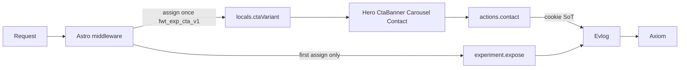

# CTA offer friction experiment

Runbook for `cta_offer_friction_v1`: a sticky, edge-assigned A/B test of two primary offers on the marketing site. Measurement uses Evlog → Axiom (same pipeline as [logging.md](logging.md)).

## Purpose

Both arms are **new** offers (the old “Digital Growth Audit” label is retired for this test). You learn which new offer wins — not whether either beats the old line.

| Variant | Button | Friction |
| --- | --- | --- |
| `control` | Book a 15-minute website review | Higher — live review |
| `variant` | Request a free site audit | Lower — async free audit |

**Primary metric:** enquiry rate = successful `contact.submit` count / **unique** `experiment.expose` count, by `variant`.

**Secondary (diagnostic only):** contact landings with `?src=cta_control` or `?src=cta_variant`. Never optimize on clicks alone. Query params must never assign or override the cookie.

## Architecture



1. Middleware assigns `control` | `variant` once, sets `fwt_exp_cta_v1` (httpOnly, 30 days), and logs **one** `experiment.expose` when the cookie is newly set.
2. Hero, CtaBanner, HeroCarousel primary CTA, and contact page SSR the assigned package (zero client flicker).
3. `actions.contact` reads the **cookie** as source of truth for attribution (ignores hidden fields and `?src=`).
4. Lead email puts variant + offer name in the **footer only** (not the subject) so you can score quality before unblinding.

## Cookies

| Cookie | Value | Role |
| --- | --- | --- |
| `fwt_exp_cta_v1` | `control` \| `variant` | Sticky assignment |
| `fwt_exp_exclude` | `1` | Opt out / operator self-exclude |

**PECR stance (not legal advice):** statistical-purposes cookie for aggregate site improvement; disclosure on [/privacy](/privacy); simple free object via [/experiments/opt-out](/experiments/opt-out). No consent banner for this cookie alone. UK GDPR: legitimate interests documented on the privacy page.

**Visitor opt-out:** footer “Opt out of site experiments” or the button on `/privacy`. Sets `fwt_exp_exclude=1`, clears `fwt_exp_cta_v1`, stops assignment and exposure logging, renders the control package as the non-experiment default.

**Exclude yourself in prod:** visit `/experiments/opt-out` once in the browser you use for QA, or set `fwt_exp_exclude=1` manually.

## Event schema

Wide events on service `faber-web-web`:

| Field | When |
| --- | --- |
| `experiment` | `cta_offer_friction_v1` |
| `variant` | `control` \| `variant` |
| `action: "experiment.expose"` | **Once** on first cookie assignment |
| `action: "contact.submit"` | Form handler; include `outcome` (`success`, `error`, `honeypot`, `turnstile_denied`) |

Do **not** treat every page view with `experiment` set as an exposure. Denominator = `experiment.expose` only.

## Monitoring in Axiom

Dataset: `AXIOM_DATASET` (typically `faber-web`). Filter `service == "faber-web-web"`.

### Sample ratio (expect ~50/50)

```kusto
['faber-web']
| where service == "faber-web-web"
| where action == "experiment.expose"
| where experiment == "cta_offer_friction_v1"
| summarize exposures = count() by variant
```

### Unique exposures by variant

Same as above if each expose is one-shot per visitor. If you ever change logging, keep one expose per assignment.

### Successful submits by variant

```kusto
['faber-web']
| where service == "faber-web-web"
| where action == "contact.submit" and outcome == "success"
| where experiment == "cta_offer_friction_v1"
| summarize conversions = count() by variant
```

### Enquiry rate

Join or manually divide conversions / exposures per variant.

### Guardrail: form errors by variant

```kusto
['faber-web']
| where service == "faber-web-web"
| where action == "contact.submit" and outcome == "error"
| where experiment == "cta_offer_friction_v1"
| summarize errors = count() by variant
```

### Optional click diagnostic

Contact page paths/queries containing `src=cta_control` or `src=cta_variant` (if path/query is logged on the page request). Diagnostic only.

## Cadence

1. After a few days: check sample ratio only. If skewed, fix assignment / cache / bots before reading rates.
2. Do **not** ship on early peeks.
3. Single analysis look after **both** ≥ **30 conversions per arm** **and** ≥ **4 full weeks**.

## Conclude

1. Bayesian calculator with a **skeptical prior** on enquiry rate.
2. Ship if **P(variant beats control) ≥ 95%** (or the reverse for control).
3. **Quality tiebreak only** if, after the floor, the 95% credible interval on the rate ratio still covers 1.0:
   - Score each lead **before** reading the email footer variant tag.
   - Rubric: **not a lead** / **weak lead** / **qualified**.
   - Then unblind using the footer line `Experiment: control|variant (…)`.

## Cleanup

When a winner is clear:

1. Hard-code the winning copy in Hero, CtaBanner, HeroCarousel, and contact.
2. Remove experiment middleware branch, `cta-experiment.ts` assignment, and opt-out UI if the cookie is gone.
3. Keep a short privacy note if still accurate.
4. Run `pnpm dlx ultracite fix` and `pnpm run check-types`.

## File map

| File | Role |
| --- | --- |
| `apps/web/src/lib/cta-experiment.ts` | Packages, cookie names, assign helpers |
| `apps/web/src/middleware.ts` | Sticky assign, expose once, `Cache-Control: private` |
| `apps/web/src/components/Hero.astro` | Primary CTA package |
| `apps/web/src/components/CtaBanner.astro` | Banner CTA package |
| `apps/web/src/components/HeroCarousel.astro` | Overrides slide primary CTA |
| `apps/web/src/pages/contact.astro` | Offer-aligned copy |
| `apps/web/src/components/contact-form.astro` | Variant submit label |
| `apps/web/src/actions/index.ts` | Cookie SoT on `contact.submit` |
| `apps/web/src/lib/contact-lead-email.ts` | Footer attribution |
| `apps/web/src/pages/privacy.astro` | Disclosure |
| `apps/web/src/pages/experiments/opt-out.astro` | Free object |
| `docs/cta-experiment.md` | This runbook |
