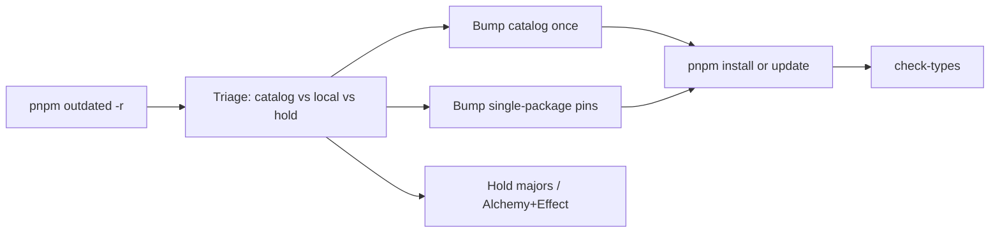

# Dependencies

This monorepo uses **pnpm** with a **catalog** so shared packages resolve to one version. Prefer catalog bumps over per-package edits. Do not run a blanket `pnpm update -r --latest` across majors.

## Source of truth

| Kind | Where | Notes |
| --- | --- | --- |
| Shared versions | [`pnpm-workspace.yaml`](../pnpm-workspace.yaml) `catalog:` | Consumers use `"catalog:"` in their `package.json`. |
| Overrides | same file, `overrides:` | Effect, `@emnapi/*`, and `hono` are intentional. Change them with the coupled package, not casually. |
| Alchemy beta pins | `minimumReleaseAgeExclude` | Keep in sync when bumping `alchemy` / `@alchemy.run/*`. |
| App-local deps | package `package.json` | e.g. `astro`, `gsap`, `tailwindcss`, `tsdown`, `turbo`, `ultracite`, `@biomejs/biome`. |

Catalog packages today include `dotenv`, `zod`, `typescript`, `@types/node`, `@cloudflare/workers-types`, `hono`, `@orpc/*`, `better-auth`, and `evlog`.

## Safe update workflow

1. Run `pnpm outdated -r`. Split rows into catalog, local-only, and intentional holds.
2. Edit `catalog:` once for shared packages. Keep all `@orpc/*` on the **same** version. Keep `better-auth` **exact** (no `^`).
3. Bump local pins only where that package is declared (root / `apps/*` / `packages/*`).
4. **Astro:** from `apps/web`, run `pnpm dlx @astrojs/upgrade` instead of hand-editing `astro`. Stay on the current major unless you are doing a dedicated major upgrade.
5. Install: `pnpm install`, or `pnpm update -r <pkg>...` for named bumps. Never blanket `--latest` across majors.
6. Verify with `pnpm run check-types`. Run `pnpm run check` when lint debt is not blocking the pass.
7. Re-run `pnpm outdated -r`. Only intentional holds should remain.

If a single bump breaks types or build, revert that pin (or fix a real regression the upgrade surfaced).

## Hold / separate PRs

Do not chase these in a routine safe pass:

- **Majors:** `typescript`, `dotenv`, `ultracite` (move Biome with Ultracite, not alone).
- **Alchemy + Effect:** bump `alchemy`, `@alchemy.run/*`, `effect`, `@effect/platform-*`, the `@effect/platform-node-shared` override, and matching `minimumReleaseAgeExclude` entries together. Smoke infra types / `alchemy` scripts in that PR.
- **`@libsql/client` `0.x`:** treat minor bumps as potentially breaking.

## Anti-drift rules

- Prefer the catalog for anything used in two or more packages.
- Align `@orpc/client`, `@orpc/server`, `@orpc/openapi`, and `@orpc/zod` together so the lockfile does not dual-install.
- Keep Effect family versions exact and override-aligned with Alchemy (see comments in `pnpm-workspace.yaml`).
- Prefer `@astrojs/upgrade` over manual Astro version edits.
